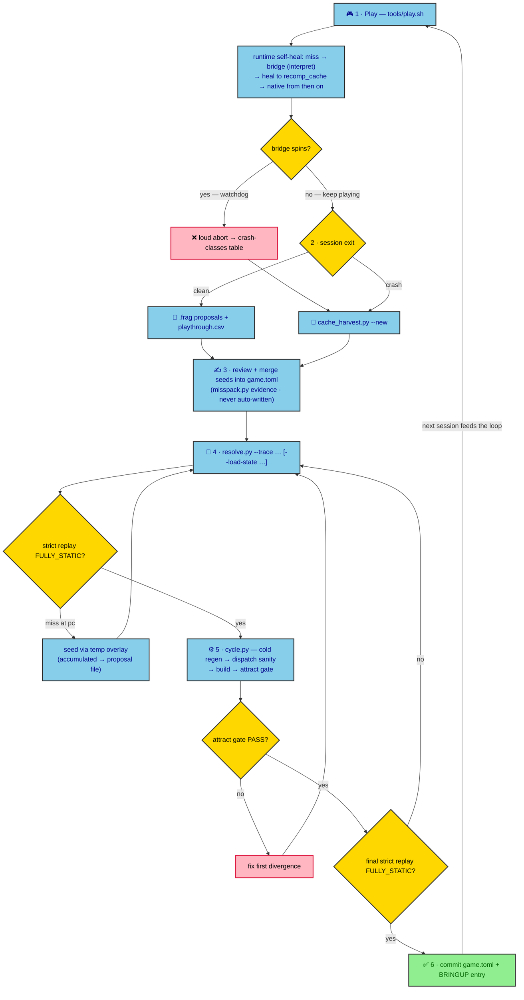

# Testing & verification — FFTA Recomp

Instrumented playtesting, the coverage/healing loop, the regression gates,
and CI. The root [README](../README.md) is the project overview (quick
start, features, controls, building); running and display options live in
[docs/README.md](../docs/README.md). Everything below assumes a built
`build/FFTARecomp` and the repo-local `.venv/`.

## Host unit tests

- **C++ (`src/` custom code, no ROM/BIOS):**
  `cmake --build build --target ffta_unit_tests && ctest --test-dir build -R ram_dispatch`
  — `ffta_ram_dispatch` (RAM-code canonicalizer) + the host-stack-guard
  test, which **compiles only where the pinned submodule declares the guard
  APIs** (`HOST_STACK_GUARD_API`; absent on a pristine checkout, it prints a
  skip — the APIs live in `tools/patches/host-stack-guard-desktop.patch`).
  Also unit-covered since the 2026-10-09 src audit: the **LZSS entry guard**
  (`ffta::lzss_entry_guard`, `src/ffta_lzss_guard.h`) — plausible length →
  declined, implausible → return-to-LR with the thumb bit stripped, and the
  exact `0x100000` boundary both sides — plus the `ram_dispatch`
  mid-copy-resume regressions (sentinel `r2 == -1` from any address,
  including a byte-matching re-plant, must pass through; two-byte-early
  entries only run on a byte-match) and the copy-count clamp semantics.
- **Frame pacer (`tests/unit/test_frame_pacer.cpp`, same binary):**
  `wait_for_next_frame(k)` throttles k periods (the issue-#8 fix — a
  4-frame present must take ~4 periods, not 1), the default paces one
  frame, uncapped returns immediately, and absurd banks clamp instead of
  sleeping for seconds. Wide timing margins (no flakes); red-verified
  against the pre-fix single-period behavior. Pristine-checkout policy
  mirrors the stack-guard test (`PACER_BANKED_API` probe — compiles to a
  skip where the patched header is absent).
- **Python tooling:** `.venv/bin/python tests/python/test_tools.py`
  (needs capstone — the `.venv`; run by `tools/check.py --only unit-py`).
  Covers the pure healing/audit logic (trace_split, cache_harvest,
  misspack prologue-scan) plus cheap structural guards:
  - **TSV shape** — `symbols/*.tsv` field counts, hex addresses, region
    vocab, C-identifier names, no duplicate names (a malformed line breaks
    regen or mislabels an emitted unit; negative-tested).
  - **Patches README parity** — the table must list exactly the present
    `*.patch` files.
  - **`gba_bios.bin` byte-pin** — sha1 + the exact words at every contract
    point the engine cites (vectors, IRQ wrapper epilogue, SWI dispatcher
    service-switch + epilogue). **Local-only:** the retail dump is
    BIOS-derived and never in git (`gbarecomp/.gitignore bios/*.bin`);
    the test skips on any checkout without it (CI included). Since the
    issue #17 swap this is REFERENCE material (the launcher-accepted
    alternative + the oracle's default), not the launch BIOS.
  - **`emibios_gba_bios.bin` byte-pin** (`EmibiosBytePinTests`) — the
    same contract-point discipline for the COMMITTED launch BIOS
    (clean-room emibios, `bios/`, LGPL): sha1/size, exception vectors,
    the IRQ trampoline + its `0x138` epilogue, the SWI dispatcher + its
    `0x194` halfword table (blob-hashed), the `.vc_irqh` handler body —
    plus the recompile TOML's essential seed inventory (accidental
    deletion fails with the name attached). **Runs EVERYWHERE** — repo
    material, no skip: the unlocked path of committing the BIOS. A
    missing bin is a broken checkout and fails loudly.
  - **`.regen_stamp` contract** (`RegenStampContractTests`) — the
    regen-date token must agree across `build.py` / `tools/cycle.py`
    (writers) and `build_apk.py` (the freshness gate reader), and the
    gate must never regress to comparing emitted corpus mtimes (the
    recompiler preserves them for byte-identical output — the
    2026-10-11 "corpus is stale forever" lesson).
- `tools/check.py` runs both, plus the patches check (every per-feature
  patch must also **forward-apply on the pristine pin** — the CI condition;
  dev-based exports go INVALID there), the recomp-ui runtime-UI tests
  (`tools/ui_check.py`, suite `ui-tests` — the in-game settings overlay is a
  patched submodule, so its model + ImGui presentation tests run too; builds
  with just a C/C++ compiler, no ROM. On a pristine checkout — CI — it
  builds upstream's tests unchanged, so the patched behavior is covered
  locally, not there), the attract gate,
  widescreen smoke and strict route replays (below).

---

## Playtesting & debugging with `tools/play.sh`

`tools/play.sh` is the **testing** entry, not the play entry — for normal
play, run the built binary directly (see `docs/README.md` § Running the
built game). It launches the windowed build with the session instrumentation
already on (input recording, live miss journaling, persistent battery save)
and archives the previous session's artifacts at launch, so back-to-back
playtests cannot clobber each other.

### Launch options

| Command | What you get |
|---|---|
| `tools/play.sh` | windowed game, instrumentation on |
| `tools/play.sh --scale N` | bigger window (1–8; 8 = 1920×1280) |
| `tools/play.sh --resize-view` | widescreen windowed — the view follows the window (up to 448 px; fixed width: `--view-width 320\|384\|448`; default stays faithful 240) |
| `tools/play.sh --fullscreen` | borderless desktop fullscreen |
| `tools/play.sh --launcher` | run the settings UI first |
| `tools/play.sh --tcp-observe PORT` | window + read-only debug port (see below) |
| `tools/play.sh --save-path saves/copy.sav` | play a different battery save (last flag wins; work on a copy — in-game saves rewrite the file) |

Notes:
- `--tcp` (without `-observe`) is structurally headless — the TCP branch
  returns before window init. For a windowed session always use
  `--tcp-observe PORT`.
- `--view-width` is the widescreen *view* feature, not a window size. FFTA
  now supports 320/384/448 (default stays faithful 240; `--resize-view`
  follows the window, windowed only). `GBARECOMP_WS_WIP` is no longer
  needed — see `reference/widescreen.md`.
- Extra flags pass straight through to `FFTARecomp`; the build must exist
  (`build/FFTARecomp`) before launching.

### Controls, savestates, saves

- **Keymap:** `build/keybinds.ini` (next to the exe; SDL scancode names =
  physical QWERTY positions). Install the verified all-letters example:
  `cp tools/playtest_keybinds.ini.example build/keybinds.ini`
  (`a=X b=Z select=Q start=D l=W r=R` + arrows). Letters are deliberate — on
  desktops with an input-method daemon (IBus/GNOME) Enter/Backspace can be
  swallowed inside game windows. Relaunch after edits.
- **Savestates:** `Shift+F1..F9` saves into slot 1–9; `F1..F9` loads. Slot
  files are `game.state1..9` at the repo root; play.sh archives the previous
  session's as `saves/stateN_prev_<ts>.state`.
- **Battery save:** Flash 64 KB, default `saves/playtest.sav` (see
  `--save-path` above for external saves).

### What a session records (live)

| Artifact | What it is |
|---|---|
| `logs/playthrough.csv` | exact `(frame, keys)` trace — replayable with `GBARECOMP_INPUT_REPLAY` (format: `reference/dev-gotchas.md` § Input trace format) |
| `logs/playtest_misses.frag` | TOML proposals for every code miss — journaled to disk the moment each miss is recorded (a hang or kill cannot lose it); rewritten with final counts at clean exit |
| `recomp_cache/…` | each miss healed on the fly into native code — the game keeps running; the frag is the offline seed queue |

A clean close (**ESC** in-game, or `tools/quit.py`) also flushes the exit
diagnostics. If the window ever refuses to close, `.venv/bin/python
tools/quit.py <port>` closes remotely and flushes exactly the same
artifacts.

### Debugging from a second terminal

`--tcp-observe PORT` serves a read-only debug surface to one client — keep a
single long-lived watcher per session.

| Tool | Use |
|---|---|
| `.venv/bin/python tools/keyprobe.py PORT` | live KEYINPUT monitor (active-low) — verifies host keys reach the guest. Click the window once (focus) first. |
| `.venv/bin/python tools/livewatch.py PORT` | frame-stall watchdog — snapshots registers, state hash and an IWRAM stack window to `/tmp/hang_*.json` the moment the frame counter stops advancing |
| `.venv/bin/python tools/hangprobe.py PORT` | read-only hang probe — registers + IF/IE/IME + FFTA wake flag + IRQ vector + miss report; safe on stalled sessions (never send `savestate_save` there — it wedges the single-client server) |
| `.venv/bin/python tools/quit.py PORT` | clean remote close (archives + flushes) |
| raw TCP reads | memory/register reads for ad-hoc questions — see `gbarecomp/TCP.md`; observe mode has no stepping |

For deeper captures (no code changes): `GBARECOMP_INSN_TRACE=1` +
`GBARECOMP_FP_SAVE=file` (per-instruction ring; query with
`tools/ringscan.py`), `GBARECOMP_WRAM_TRACE` (+`_LO`/`_HI`),
`GBARECOMP_MISS_IWRAM_DUMP` — details in `reference/dev-gotchas.md`.

### Recipes

- **A hang.** Leave the window frozen and run `livewatch.py` — the snapshot
  names the pc/state. Close with `quit.py`, then reproduce offline:
  `tools/spinhunt.py <trace> <save> <frames>` bisects strict replays; the
  frag/cache shows what to seed. (Crash classes: the table in the next
  section.) On an Android device, probe read-only first
  (`tools/hangprobe.py`) — a savestate request wedges the observe server on
  a stalled guest, and the session's `/proc` is evidence (recipe:
  `reference/dev-gotchas.md` § Android device forensics).
- **A missing-coverage stretch.** Just play — every miss is journaled; then
  run the healing loop below (harvest → misspack → merge → resolve →
  cycle).
- **Audio faults (crackle / ramping / dropouts).**
  `GBARECOMP_AUDIO_PROBE=1` prints bridge stats every 120 pushes: healthy
  is `corr` near 0 with `fill_ms` near 60 and zero underruns/stretch/
  overflows; sick is `corr` railed at ±0.500% with high fill and climbing
  `overflow_drops` (producer faster than the device) or `bridge_underrun`/
  `stretch` (slower). A/B `GBARECOMP_AUDIO_DIRECT=1` (raw SDL queue, no
  smoothing — dropouts instead of concealment). Deeper: TCP `audio_state`
  (mixer rate, samples_generated, SOUNDBIAS, cycles/sample),
  `GBARECOMP_FRAME_PHASE=path` (per-visit guest/pacer split),
  `GBARECOMP_SAMPLE=1` (hot-PC histogram). Knobs live in
  `gbarecomp/src/runtime/host_window.cpp` + `recomp_audio_drc.h`; note the
  mixer is mono and FFTA runs with the MP2K shadow off (`game.toml`).
- **Save flows / external saves.** Play on a copy (`--save-path`), validate
  structurally with `tools/savecheck.py`; oracle comparisons:
  `tools/dualrun.py probe saveflow`.
- **Long sessions.** Supported — present-in-place + background healing keep
  long runs stable, and the frag stays current throughout.
- **Widescreen.** `tools/play.sh --scale 4 --resize-view` (or
  `--view-width 448`) — ring scenes (battle/pub) fill the margins with the
  game's own field content; the world map and menus stay pillarboxed /
  native; the automated smoke test is `tools/ws_check.py`.
  `reference/widescreen.md` is the map.

### Housekeeping

- Don't run builds or second game instances while a session is live —
  background heal compilation competes for CPU.
- `logs/` and `saves/` are gitignored — never force-add session captures.
- After a session, gate the tree before calling it good:
  `.venv/bin/python tools/check.py` (see Verification & regression).

## Desktop acceptance (TCP-observed suspend-save press)

`.venv/bin/python tools/desktop_accept.py --mode tcp` — headless free-run
`--tcp` acceptance for the state3 suspend-save press: savestate load, 3 s
wait, A press, scored observation (press seen, frames advance, screen
animation, no abort; the close/resume mechanisms reported). Needs the
local `game.state3` + `saves/playtest.sav`; evidence in
`logs/desktop_accept/`. `--mode window` runs the same scoring on
`play.sh` + `--tcp-observe` (ydotool input).

## The playtest → healing loop

This is the core contribution workflow, and it is what every play session
feeds. When the game executes code that has not been statically recompiled
yet ("a miss"): the runtime **bridges** it with the reference interpreter,
**heals** it by compiling it on the fly into `recomp_cache/` (used natively
from then on), and **records a TOML proposal** for the offline corpus. A
watchdog aborts loudly if a bridge ever spins (never silent corruption).

The diagram below maps the loop end to end; the numbered steps that follow
are the same loop in prose.

**1 — Play.** `tools/play.sh [--scale 8]` and just play. The launcher
instruments everything:

| Artifact | What it is |
|---|---|
| `logs/playthrough.csv` | your exact input trace — replayable (`GBARECOMP_INPUT_REPLAY`; format: `reference/dev-gotchas.md` § Input trace format) |
| `logs/playtest_misses.frag` | TOML proposals — **journaled live as misses occur** (an unclean close/kill no longer loses them) and rewritten with final counts at a clean exit; play.sh archives the previous session's as `saves/frag_prev_*.frag` |
| `recomp_cache/<sha>/gcc/<plat>/<abi>/` | completed heals: `<PC>_<hash>_<t\|a>.{c,dll,log}` |
| `saves/` | archived previous-session savestates + traces, battery save |

**2 — Close the session.**
- The `.frag` is written as you play (every new miss journals the proposal),
  so both clean exits and kills/hangs leave the miss list on disk; a clean
  exit rewrites it with final counts.
- If a session still looks odd, recover the healed PCs with
  `.venv/bin/python tools/cache_harvest.py --new` (reads the heal cache
  filenames). Paste the terminal output too — abort messages name the pc.

**3 — Merge reviewed seeds** into `game.toml` (`[[extra_func]]` /
`[[jump_table]]` / `[[code_copy]]`, each with a disassembly-evidence `note`;
`tools/misspack.py <frag>` builds the evidence pack). Never auto-write
`game.toml`; proposals are reviewed. **Same-session symbols check** (the
step that keeps getting missed): every newly-identified function gets a
naming-only entry in `symbols/ffta_symbols.tsv`, and every newly-identified
dispatch/pointer table gets a data-symbol entry in
`symbols/ffta_data_symbols.tsv` with its measured size (walk to the
terminator — replace the `0x0` size-unknown placeholder). Coverage comes
from the `game.toml` seeds; the symbol tables are how the *next* session
recognizes what this one found — skipping them is how a whole subsystem
gets re-discovered from scratch (the 2026-10-11 gAbilityAnimationTable
lesson).

**Device playtests journal too** (report-only bridges): the runtime
writes `recomp_master_misses_AFXE.toml.frag` to the external app dir
(`/sdcard/Android/data/<pkg>/files/logs/`, issue #6 logging) — pull and
review it in the same session, exactly like a desktop frag. An unharvested
device journal is silent coverage debt (the 2026-10-11
gAbilityAnimationTable batch: 218 records sat invisible until a gate run
resumed that session's suspend state — BRINGUP same date).

**4 — Resolve to static.** `.venv/bin/python tools/resolve.py --trace
logs/playthrough.csv [--load-state saves/<state>] [--frames N]` — it
strict-replays your session, seeds each miss through a temporary overlay,
rebuilds and repeats until `FULLY_STATIC`, then writes the accumulated seeds
to a proposal file for merging. If you reloaded a savestate mid-session, the
trace jumps backward and replay rejects it — split it first with
`.venv/bin/python tools/trace_split.py --trace logs/playthrough.csv` and
resolve each segment from the same start state.

**5 — Verify.** `.venv/bin/python tools/cycle.py` (cold regen →
dispatch-alignment sanity → build → attract gate) and one final strict replay
of the session as the acceptance: `GBARECOMP_STRICT_STATIC=1
GBARECOMP_INPUT_REPLAY=logs/playthrough.csv ./build/FFTARecomp ...` — expect
`self_heal_coverage=FULLY_STATIC dispatch_misses=0`.

**6 — Commit** `game.toml` + a dated entry in `BRINGUP.md`. Never commit
`logs/`, `saves/`, `generated/`, or anything else ROM-derived.

**Crash classes you may meet** (all loud, all documented in `BRINGUP.md`):

| Message | Meaning |
|---|---|
| `dispatch miss for pc=… no generated function` | Normal coverage gap: bridged + healed. Feed it to the corpus. |
| `SELF-HEAL bridge for 0x… exceeded 200000000 instructions … Aborting` | Bridge stop-contract limitation (crash #1/#2 in BRINGUP). Harvest the cache, seed the path static, retry. |
| `SELF-HEAL bridge hit interpreter NotImplemented/Undefined at pc=…` | A genuine interpreter-lowering gap in gbarecomp. Report; fix belongs upstream. |

## Verification & regression

- **Strict mode** (`GBARECOMP_STRICT_STATIC=1`) disables the heal cache,
  background healing, and interpreter bridging — any miss aborts. A green
  strict run is the definition of "statically recompiled".
- **Attract gate:** `tools/attract_check.py` pins the SHA-256 of a 1200-frame
  attract run; it runs inside `cycle.py` after every `game.toml` change.
  `--repin` only for deliberate visual changes. Since the HLE flip it pins
  itself to LLE (`GBARECOMP_BIOS_HLE=0`): the attract frame sits mid-intro-
  movie (timing-chaotic content), so the pin guards rendering on the
  oracle-faithful path while `hle_audit.py` owns the HLE path.
- **HLE audit:** `tools/hle_audit.py` (gate suite `hle-audit`) forces
  `GBARECOMP_BIOS_HLE=1` and runs attract + battle route B with the SWI
  census (`GBARECOMP_SWI_LOG`) and HLE-taken trace (`GBARECOMP_SWI_TRACE`):
  every executed SWI must be in the HLE-implemented set (mirrored from
  `bios_hle.cpp`) and HLE-taken (no silent LLE fallback), both routes
  FULLY_STATIC, route-B final frame matching its pin (`--repin` for
  deliberate changes, same policy as attract). Red-verified both ways
  (HLE-off and dropped-SWI fail the gate). Attract pixels are deliberately
  NOT pinned here (movie chaos — see above).
- **Widescreen smoke:** `tools/ws_check.py` — for each scene fixture x view
  width it compares the wide render's center against a faithful 240 render
  (must be pixel-identical), censuses the margins against the per-scene
  policy (ring scenes filled, world map pillarboxed), guards against stale
  margins (idle-vs-pan must differ), and covers the scene transitions
  (mid-fade: margins never brighter than the center; pub exit: pillarbox
  restored). Needs its dedicated sha-pinned fixture copies
  (`saves/ws_fixtures/*.state` — local-only, gitignored; exit 2 when
  missing or changed). The copies keep the player's `game.state1..9` slots
  free for GUI testing; runs in parallel (`--jobs`); 6 cases x 320/384/448
  in seconds. Backend A/B: `GBARECOMP_BIOS_HLE=0 tools/ws_check.py --keep`
  replays the same fixtures under LLE (the scrub passes that one var
  through) — all 24 frames must be pixel-identical to the HLE default run,
  which is how the HLE flip was validated on stable content.
- **Render-path cadence gate:** `tools/cadence_probe.py` (suite `cadence`)
  — the compute-at-60/read-at-30 detector. Pauses the pacer on a headless
  `--tcp` session, loads the battle-overview pan fixture (`game.state1`,
  local-only; exit 2 when missing), steps exactly one VBlank at a time with
  Right held, and snapshots IO/IWRAM/OAM/PAL (+VRAM on request) per step.
  Asserts the 60 Hz scheduler invariants (the frame_step staging parities
  toggle every VBlank and stay equal, `gVblankCounter` +1/step) and that no
  presented surface (io/oam/pal/vram + the display-reg shadow) has an
  every-other-frame consumer (strictly alternating change steps). IWRAM
  staging alternation is the double-buffer slot write — reported as the
  two-phase signature, never gated. `--strict` gates the sweep;
  `--regions`, `--traces`, `--json` for RE work. Verdict this guards:
  BRINGUP § 2026-10-12 (late 12) — ffta's render path is 60 Hz end to end,
  there is no every-other-frame read gate to patch (unlike MKSC's affine
  track). Measurement mode (walk/magic/summon takes): `--replay
  inputs/cadence_<flow>.csv --frames N --regions io,oam,pal --watch
  <addr:len,...>` re-drives a recorded flow (first non-idle input lands
  at step 8; traces are change-only, so extend `--frames` well past the
  last input to cover animation tails). On long runs read
  `burst_alternating` (localized gap-2 subruns with step windows, every
  window value-traced) alongside the gate — full-history alternation
  dilutes when a burst is followed by later changes to the same byte —
  and confirm byte-level flags at sprite/entry level before claiming
  anything (recycled OAM slots mimic strict alternation over short
  windows). Measured verdicts: BRINGUP late-13 entries + issue #9
  (60 Hz motion everywhere; 30 Hz content confined to authored
  palette-fade ticks).
- **Full gate:** `.venv/bin/python tools/check.py` — host unit tests
  (C++ + Python), patch validity, the device-free Android checks, the
  attract gate, the widescreen smoke,
  and strict route
  replays (user
  save-load, sessions G/K, battle movement route B) against frozen fixtures in `saves/regress/`
  (sha-pinned). Run it before declaring "no regressions"; checks run
  concurrently by default (`--jobs N`; auto = min(8, CPUs) — `--jobs 1` for
  serial) with per-run save/coverage isolation; `--fast` for the quick
  subset. `tools/savecheck.py` validates raw/RTN5 saves offline.
  The `saves/regress/` fixtures are local-only (never redistributed), so a
  fresh clone has nothing to replay: use
  `--only unit-cpp,unit-py,patches,android-static` (the CI subset — no dumps
  needed) or
  `--only attract` (dumps but no fixtures) until you have regenerated routes
  by playing + resolving; `--fast` also needs the fixture for its
  `savecheck` step.
- **Coverage lenses:** `tools/coverage_report.py` reports executed path
  (ground truth), walker's static reach, and pointer-pool reach (a proxy —
  not a goal; FFTA needs FULLY_STATIC on executed paths, not 100 % of a
  proxy). `--json` for machine-readable output.
- **Android device gate:** `tools/validate_android.sh` — installs the newest
  debug APK, launches through AUTOSTART, asserts process/activity/runtime-log/
  crash health, and pulls evidence into `android/artifacts/last-run/`. Build,
  run and known device behavior: `android/README.md`; on-device forensics:
  `reference/dev-gotchas.md` § Android device forensics.
- **Android, device-free:** `tools/android_static_check.py` (suite
  `android-static`; CI tier 1) — identity/pin consistency across
  `android/app/build.gradle` / `game_android.toml` / `game.toml` (including
  the optional `.sav` setup-import wiring, issue #20), the mods
  payload contract (`state.toml` keeps widescreen enabled), tracked-file
  hygiene, and a fake-`adb` self-test of the device gate script (clean run
  passes; SELF-HEAL / missing-log / crash / setup-still-resumed runs fail).
  No SDK or device needed; guide: `android/README.md`.
- **Android APK content guard:** `tools/android_apk_check.py` (opt-in:
  `check.py --only android-apk`; needs a built APK) — the packaged payload
  must byte-match the staging sources, private embeds are hash-checked
  against the pins, public embeds must be absent, `libmain.so` once per ABI,
  manifest facts, and duplicate / stray / oversized zip entries. Run after
  `./gradlew :app:assembleDebug` (android/README.md § Build).
- **Suspend→A press regression (phantom IRQ close):** `tools/hangrepro.py`
  (opt-in: `check.py --only hangrepro`) — deterministic steppable repro of
  the 2026-10-09 hang (`savestate_load game.state3` → A). Since the
  irq-handler-abandon-close fix the abandoned IRQ must be closed
  (`closing the IRQ` in the log) and the flow advances past the old wedge
  (typically ending at the coverage boundary — a separate, tracked state);
  the former SIGSEGV-at-~+26 / guard-bounded hang must not return; the
  loop's host-frame recursion itself is gone (split-loop gap roll-in,
  2026-10-09). Skips
  when the gitignored `game.state3` / `saves/playtest.sav` are absent.
  BRINGUP § 2026-10-09.

Current snapshot (2026-10-09, strict 1200-frame run; refresh with
`.venv/bin/python tools/coverage_report.py`):

| Lens | Mapped / total | % |
|---|---|---|
| **Executed path** (strict 1200-frame run) | everything that ran | **100 % — FULLY_STATIC, zero interpreter fallback** |
| **Walker's static reach** (whole-ROM scan trial) | **55,102 / 56,332** emitted units | **≈ 97.8 %** |
| **Pointer-pool reach** (speculative-harvest trial) | **55,102 / 55,514** | **≈ 99.3 %** |

Rows 2–3 are proxies with different denominators (no ground-truth function
inventory exists); a route is done when its replay is FULLY_STATIC. Corpus:
55,102 emitted units (interior split units + IWRAM code-copy included;
55,103 before the 2026-10-09 split-loop gap roll-in merged
`vblank_wait_loop_cont` into its host as a resume alias); the
speculative-harvest trial kept 2,204 pointer candidates out of 105,815
PC-relative literals (`false` in `game.toml` by policy).

**Save flows — resolved (2026-10-08).** The 2026-10-07 stall/runaway class on
certain save contents was root-caused to a bug on OUR side, not a guest
divergence: the save driver re-plants its byte-copy helper per call, and a
mid-copy IRQ resume could byte-match a fresh plant and re-run the canonical
body (stack tear → the driver's epilogue popped a scan-buffer pointer as a
return address; aborts like `pc=0x02003CB0` / `0x700200F2`). The ram-dispatch
hook now passes every `r2 == 0xFFFFFFFF` resume through to the fixed table's
resume labels (commit `1eeb60f`): the save flow completes, the found-save
repro (`saves/found_save.mGBA.sav` + `saves/trace_sessionL_1736.csv`) and all
save routes replay strict-clean, and the open-bus reads the fix exposed are
oracle-identical (BRINGUP §§ cont.2–cont.4; driver-call tooling:
`tools/readseq_probe.py`). Remaining minor observation: a ~950-frame
native-vs-oracle offset for the same flow (open; no state divergence in the
compared windows).
- **Oracle frame-diff:** `tools/framediff.py --lo 4 --hi 300` (native vs the
  framework's mGBA oracle; bounded band diffs on animated content are
  expected and documented in BRINGUP § "park-phase semantics") and
  `tools/dualrun.py` for lockstep region/pixel probes.
- **Acceptance replays in the repo today:** boot → new game
  (`inputs/title_to_newgame.csv`, 6000 f), the battle continuation
  (`inputs/session2_battle_trace.csv` + a matching state), battle movement
  + actions (`saves/regress/battle_move_trace.csv` from
  `battle_move_start.state`, 5094 f — `route_B` in `check.py`, state-based
  via `strict_route_state`), each session's
  own trace (via `resolve.py`), and the found-save load repro
  (`saves/found_save.mGBA.sav` + `saves/trace_sessionL_1736.csv`). All
  strict-clean as of the last commit.

## Continuous integration

Two tiers, split by what may leave your machine:

- **Tier 1 — `.github/workflows/ci.yml` (fork-safe, no private material).**
  Runs on GitHub-hosted runners for every push/PR: checks out the pinned
  submodules (**pristine at the pin** — local framework edits live only in
  working trees, never pushed), installs the build packages, configures, and
  runs `tools/check.py --only unit-cpp,unit-py,patches,android-static` —
  the host unit tests (C++/Python), patch integrity (per-feature patches
  forward-validated against the **pristine pin**, so it works on a fresh
  clone), and the device-free Android checks (identity pins, payload
  contract, tracked-file hygiene, a fake-`adb` self-test of the device gate
  script; no SDK needed). It needs no ROM or savestates, and therefore
  cannot run the game itself (the ROM byte-pin and stack-guard tests skip
  there). The launch BIOS **is** repo material since the emibios swap
  (`bios/`, LGPL — issue #17), so tier 1 verifies the BIOS pin end-to-end
  (committed bin == TOML == manifest pin; the retail-dump byte-pin test
  stays local-only and skips).
- **Tier 2 — the full gate (`attract`, `ws_smoke`, route replays).** Needs
  `game.gba` + the sha-pinned local fixtures (`saves/ws_fixtures/`,
  `saves/regress/`), which are game-derived and never committed. Run it on
  a **self-hosted runner with the material pre-placed**, or a job that
  fetches a private fixture bundle under a token — gated to
  `push`/`workflow_dispatch` and **never** exposed to fork-PR workflows
  (a PR job on a runner that can read the ROM is an exfiltration path).
  The sha pins (regress save + the ws fixtures) fail loudly if the
  runner's fixtures drift.
- The **Android device gate** (`tools/validate_android.sh`) is device-bound
  and manual — no phone in CI — so it is not part of either tier. The
  **APK content guard** is device-free but needs a Gradle build (SDK/NDK),
  so it stays opt-in (`--only android-apk`) until a suitable runner exists
  (build, run, guard: `android/README.md`).
- The **release packager** (`tools/make_release.py`, `--only release`)
  needs a built **and fresh** tree (it refuses a binary older than the
  corpus or a regen input newer than `.regen_stamp`) but never the ROM —
  its sweep would reject the ROM (hash-pinned, under any name) if one
  leaked in. Local/tier-2 by nature: CI tier 1 builds no game binary. Its
  pure logic (sweep + zip writer) is unit-tested on synthetic stages in
  `tests/python/test_tools.py` (`ReleasePackTests`), which **does** run on
  tier 1. The packaged zips are deterministic (fixed timestamps, sorted
  entries), so a release job can hash them and users can diff releases:
  `--windows` cross-compiles the static Windows exe (MinGW,
  `GBARECOMP_STATIC_RELEASE`), guards the PE import table (system DLLs
  only — link-time `-s`, never post-link strip, per the R2 determinism
  lesson), sweeps the same ROM/BIOS/binary rules, and wine-smokes the
  bare extraction to FULLY_STATIC.
- **Release — `.github/workflows/release.yml` (tier 2, tag-triggered).**
  A `v*` tag push (write access — fork PRs can never trigger it)
  bootstraps the full tree on the self-hosted runner — the ROM comes from
  the runner's `FFTA_ROM` env var (pre-placed outside the workspace, never
  in git) and is copied in for the corpus regen only — then runs the full
  gate and packages every artifact (`tools/make_release.py --apk`, and
  the static Windows cross-build `--windows` once the prefix exists).
  Every attached file is content-guarded **before** the release exists:
  the zips by the make_release sweep (ROM sha1 under any name; the
  Windows exe additionally by the PE static-link guard and a wine
  FULLY_STATIC smoke), the APK by `android_apk_check --expect
  public`. `workflow_dispatch` runs the whole pipeline except the attach
  step — a rehearsal that publishes nothing.

